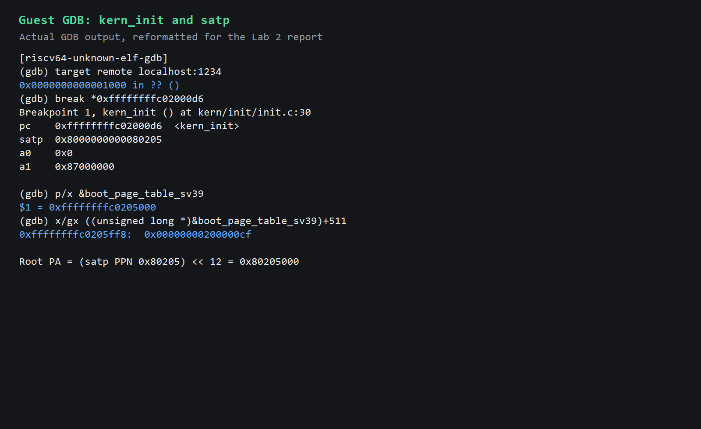
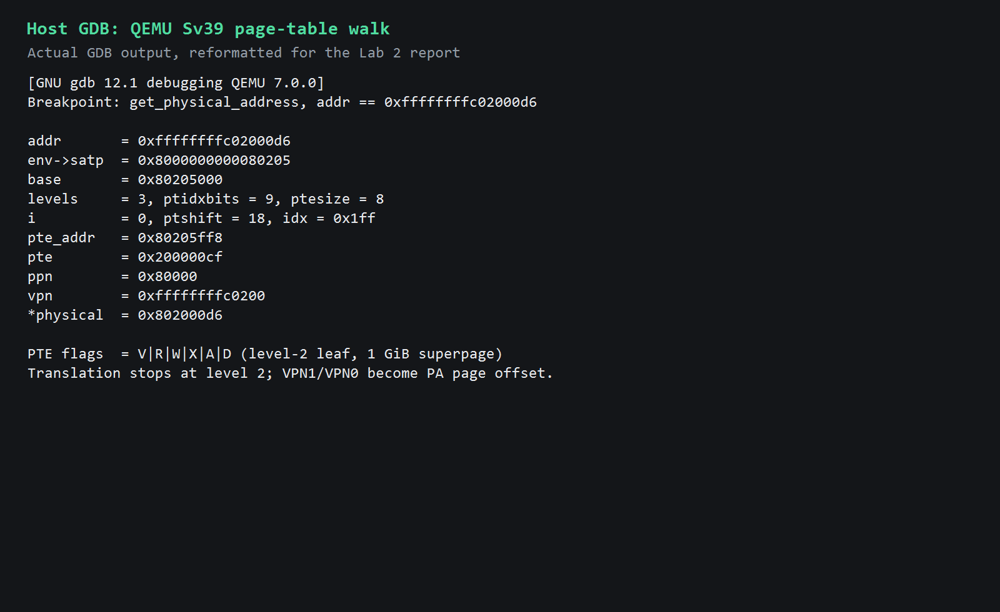
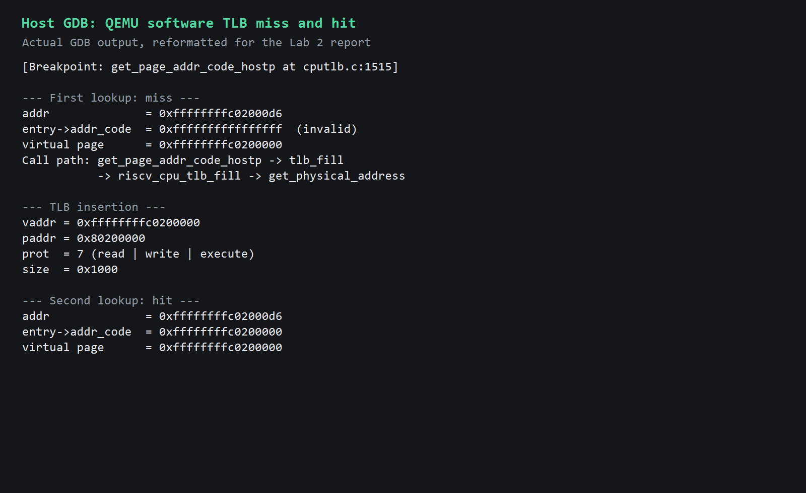

# 操作系统实验报告

## 实验基本信息

| 项目 | 内容 |
|------|------|
| **实验名称** | Lab 2：物理内存和页表 |
| **姓名/学号** | 王帅 / 2413995 |
| **完成方式** | 个人独立完成 |

---

# Lab 2：物理内存和页表

## 第一阶段：物理内存初始化与 Best-Fit 分配器

### 一、阶段目标

本阶段完成以下功能：

1. 从设备树读取物理内存基址和大小，建立 `Page` 描述符数组。
2. 保留 OpenSBI、内核镜像、对齐空隙和描述符数组占用的页面。
3. 将剩余完整物理页交给物理内存管理器。
4. 实现 Best-Fit 连续物理页分配器，并替换默认 First-Fit 管理器。
5. 通过实验自带的 Page Init、Best-Fit 测试和 QEMU 运行验证。

### 二、修改文件

| 文件 | 修改内容 |
|------|----------|
| `code/kern/mm/pmm.c` | 实现 `page_init()`，切换到 `best_fit_pmm_manager` |
| `code/kern/mm/best_fit_pmm.c` | 实现完整 Best-Fit 管理器并注册 `best_fit_pmm_manager` |
| `code/kern/init/entry.S` | 为分页切换增加低地址恒等映射，同时保留高地址内核映射 |
| `code/Makefile` | 将 QEMU 内核加载方式改为新版 OpenSBI 可识别的 `-kernel` |
| `code/tools/grade.sh` | 使自动评分使用同样的 `-kernel` 启动方式 |

原有 `default_pmm.c`、`basic_check()`、`best_fit_check()` 和 `default_check()` 均未修改。

### 三、核心实现

#### 3.1 物理内存初始化

`page_init()` 首先调用 `get_memory_base()` 和 `get_memory_size()` 获取设备树报告的物理内存范围，并检查零值、加法溢出和可管理上界。

随后设置：

```c
va_pa_offset = PHYSICAL_MEMORY_OFFSET;
npage = PPN(ROUNDDOWN(managed_end, PGSIZE));
pages = (struct Page *)ROUNDUP((uintptr_t)end, PGSIZE);
```

`pages` 数组覆盖 `[nbase, npage)` 中的物理页。初始化时所有描述符均设为 Reserved；描述符数组的物理末端再次向上按页对齐，只有其后到物理内存末端之间的完整页面才通过 `init_memmap()` 加入空闲区。若设备树信息无效或描述符数组超出内存范围，则调用 `panic()`；若没有剩余完整页面，则不调用 `init_memmap()`。

#### 3.2 Best-Fit 分配器

Best-Fit 使用 `free_area_t` 保存地址有序的空闲块链表和空闲页总数。

- 初始化：清空链表并将 `nr_free` 置零。
- 登记空闲区：清除 Reserved 状态，以块首 `Page.property` 记录连续页数。
- 分配：扫描全部空闲块，选择满足请求的最小块；多余部分形成新的空闲块。
- 释放：按物理地址插入链表，再分别检查并合并前后相邻块。
- 统计：`nr_free_pages()` 返回当前空闲页总数。
- 检查：管理器的 `check` 指向实验原有的 `best_fit_check()`。

### 四、实际测试结果

#### 4.1 page_init 单独编译

执行：

```bash
make -C code obj/kern/mm/pmm.o
```

结果：

```text
+ cc kern/mm/pmm.c
```

`pmm.o` 编译成功。

#### 4.2 完整编译

执行：

```bash
cd code
make clean
make -j2
```

所有内核源文件成功编译，并生成：

```text
bin/kernel
bin/ucore.img
```

#### 4.3 自动评分

最终执行 `make grade` 的真实结果为：

```text
lab2 injection complete
  -check page init:                          OK
  -check best fit:                           OK
Total Score: 20/20
```

自动评分在临时目录中注入并执行测试，当前源码中的原有测试函数没有被修改。

#### 4.4 QEMU 运行

执行：

```bash
make qemu
```

关键输出为：

```text
Domain0 Next Address      : 0x0000000080200000
Physical Memory from DTB:
  Base: 0x0000000080000000
  Size: 0x0000000008000000 (128 MB)
  End:  0x0000000087ffffff
(THU.CST) os is loading ...
memory management: best_fit_pmm_manager
physical memory map:
  memory: 0x0000000008000000, [0x0000000080000000, 0x0000000087ffffff].
check_alloc_page() succeeded!
satp virtual address: 0xffffffffc0205000
satp physical address: 0x0000000080205000
```

内核随后进入设计中的死循环，测试时由 `timeout` 发送终止信号结束 QEMU。

### 五、问题与解决方法

1. **老师提供的初始框架无法完整编译**

   `best_fit_pmm.c` 只包含测试函数，测试直接使用尚未定义的 `free_list` 和 `nr_free`。按照任务要求实现 Best-Fit 私有状态和全部管理函数后，完整编译通过。

2. **首次 `make grade` 得到 `0/20`**

   QEMU 输出显示 `Domain0 Next Address` 为 `0x0`。原因是旧式 `-device loader` 只把镜像放入内存，没有让当前 OpenSBI 将其作为下一阶段内核。将 Makefile 和评分脚本改为 `-kernel bin/ucore.img` 后，Next Address 变为 `0x80200000`。

3. **修改加载参数后内核仍无输出**

   OpenSBI 已跳转到 `0x80200000`，但启动页表只有高地址映射。写入 `satp` 后，CPU 仍在低物理地址执行，下一条指令无法取出。为 VPN2[2] 增加 `0x80000000 -> 0x80000000` 的恒等映射后，内核能够平稳切换到高地址继续运行。

4. **描述符数组边界风险**

   初版代码在初始化全部描述符后才计算数组物理末端。边界复查后，将数组末端和物理内存上界检查提前，防止极小内存范围下越界写入。

### 六、本阶段结论

物理内存初始化和 Best-Fit 连续页分配已经完成，完整编译、自动评分和 QEMU 运行均通过。当前结果尚未推送到远程仓库，等待确认后再提交。

## 必做练习与思考题补充

### 一、First-Fit 四个核心函数

本节依据未修改的 `code/kern/mm/default_pmm.c` 分析老师提供的 First-Fit 实现。

1. `default_init()`：初始化全局空闲链表 `free_list`，并把空闲页总数 `nr_free` 置为 0。此时分配器已可接收物理内存区域，但还没有登记任何空闲页。
2. `default_init_memmap(base, n)`：逐页确认页面原先处于保留状态，清除旧标志、引用计数和 `property`；把连续区域的首页 `base->property` 设为 `n` 并标记 `PageProperty`，增加 `nr_free`，最后按物理地址顺序把该块插入空闲链表。只有每个空闲块的首页保存块大小。
3. `default_alloc_pages(n)`：若总空闲页不足则返回 `NULL`；否则从链表头开始寻找第一个 `property >= n` 的块。找到后移除原块；若块大于请求，就把剩余部分从 `page + n` 开始作为新空闲块重新插入；随后减少 `nr_free`、清除已分配块首页的空闲块标记并返回。这正是“首次适配”的含义。
4. `default_free_pages(base, n)`：逐页检查该范围不是保留页或已有空闲块，清理状态后把 `base` 登记成大小为 `n` 的空闲块，按地址插回链表并增加 `nr_free`；随后分别检查前驱和后继是否在物理地址上连续，若连续则合并，避免相邻空闲区长期碎片化。

### 二、First-Fit 的改进空间

当前实现结构简单，但每次分配最坏需要线性扫描全部空闲块，复杂度为 `O(F)`（`F` 为当前空闲块数）；长期优先使用低地址块也容易在链表前部形成许多小碎片。可采用游标式 Next-Fit 减少重复扫描，或按大小建立分级空闲链表、平衡树以加速查找；还可以使用 Buddy System 降低合并成本。代价是元数据、实现复杂度和内部碎片可能增加，因此不能只比较查找速度。

### 三、Best-Fit 的改进空间

本实验的 Best-Fit 会扫描全部空闲块，选出不小于请求且大小最接近的块，再进行拆分；释放时仍按物理地址插入并合并相邻块。它能减少一次分配留下的剩余块，但不保证整体碎片最少，而且完整扫描同样是 `O(F)`。可同时维护按大小索引的树或分级链表以快速找到最小可用块，并保留地址索引用于相邻合并；也可为常用小尺寸设置快速路径。双索引会增加维护成本，大小桶还可能牺牲精确的“最优”选择。

### 四、物理内存范围未知时如何探测

操作系统通常不应盲目读写地址来猜测 RAM，因为物理地址空间中可能存在设备、固件和保留空洞。更可靠的方法是由启动固件或引导程序传入经过平台描述的内存映射：本实验在 RISC-V/QEMU 上由 OpenSBI 传递 DTB，`dtb_init()` 解析设备树中的 memory 节点，`page_init()` 再通过 `get_memory_base()` 和 `get_memory_size()` 取得范围并检查溢出、对齐和管理上界。其他平台可使用 UEFI memory map、x86 E820/ACPI 等机制。只有在平台规范允许时才把硬件探测作为受控的后备方案，并且仍须排除固件、MMIO 和保留区域。

### 五、从探测到可分配页面的关系

DTB 给出的是物理内存总体范围，并不等于全部可用。`page_init()` 先根据内核末尾放置 `struct Page` 描述符数组，将 `[nbase, npage)` 对应描述符初始化为保留状态，再把内核镜像、对齐空隙和描述符数组之后的完整页面交给 `pmm_manager->init_memmap()`。这样 `page2pa()`、`pa2page()`、保留页标记和空闲页集合才保持一致，也避免把 OpenSBI 或内核自身覆盖掉。
## 第二阶段：Buddy System 分配器与独立测试

### 一、阶段目标

在不影响默认 Best-Fit 评分行为的前提下，实现真正的伙伴系统，并为其设计可在内核中执行的独立测试。测试重点不是“能够分配”，而是验证按 2 的整数次幂管理、逐级拆分、伙伴识别、递归合并、计数一致性和异常路径。

### 二、修改文件

- `code/kern/mm/buddy_pmm.c`：实现伙伴分配器、内部一致性检查及七类独立测试；
- `code/kern/mm/buddy_pmm.h`：声明 `buddy_pmm_manager` 和 `buddy_check()`；
- `code/kern/mm/pmm.c`：按 `USE_BUDDY_PMM` 选择 Buddy，默认仍选择 Best-Fit；
- `code/Makefile`：增加 `PMM=buddy` 可选构建模式；
- `report/prompt.md`：记录 Buddy 实现 Prompt 和本次测试 Prompt。

老师原有的 First-Fit、Best-Fit 测试，以及 `tools/test_lab2.c`、`tools/grade.sh` 均未修改。

### 三、测试隔离方法

测试开始时，先通过真实 Buddy 分配器申请一个 32 页连续块作为测试区域，并记录此时的空闲页总数和每一阶空闲链表头。随后临时清空管理器的各阶链表，只把这 32 页按用例需要重新登记，因此测试中的拆分、分配、释放和合并不会接触测试区域之外的真实空闲页。

每组用例结束后都会检查内部结构；全部测试结束时，将测试区域恢复成一个“已分配的 32 页块”，还原原有链表和计数，再通过真实释放路径归还该块。最后断言空闲页总数与测试开始前完全相同。

非规则区域用例使用测试块中的 `arena + 1` 到 `arena + 29`，左右保留页面继续保持 Reserved，既覆盖非对齐起点和非 2 次幂长度，也防止测试越界。

### 四、测试覆盖与有效性

1. **基本分配与释放**：依次申请 1、2、4、8 页，检查返回区间位于测试区域内、互不重叠、块大小正确；逆序释放后确认恢复为完整 32 页块。
2. **非 2 次幂请求**：申请 3、5、7 页，直接检查分配块头记录的实际大小分别为 4、8、8，验证向上取整规则。
3. **逐级拆分**：从单个 32 页块申请 1 页，检查偏移 1、2、4、8、16 处分别形成 1、2、4、8、16 页的剩余块，证明每一阶拆分均真实发生。
4. **伙伴合并**：连续申请四个单页块，先释放偏移 1 和 2 的页面。二者物理相邻但不是同阶伙伴，此时断言没有错误合并；随后释放真正伙伴，检查先合并为 2 页，再递归恢复成 32 页。
5. **内存不足**：占满 32 页后再次申请，以及申请 33 页，均必须返回 `NULL`；失败前后空闲页计数和链表结构保持一致。
6. **非规则初始区域**：登记偏移 1、长度 29 页的区域，检查保护页仍为 Reserved；由于地址对齐限制，16 页请求失败且状态不变，小块分配与全部回收后总数恢复到 29。
7. **状态一致性**：混合申请 1、2、3、4、5 页，并按交错顺序释放；每一步都调用内部校验，检查块对齐、链表阶数、保留标志、未合并伙伴和空闲页计数。

每项成功信息都位于对应断言之后；任一条件不满足都会由 `assert()` 终止内核，因此 PASS 不是预设输出。

### 五、实际编译与运行结果

Buddy 模式使用以下命令重新清理并编译：

```bash
make clean
make PMM=buddy -j2
timeout --signal=TERM 12s make PMM=buddy qemu
```

QEMU 中的真实关键输出如下：

```text
memory management: buddy_pmm_manager
Buddy test 1 - basic allocation: PASS
Buddy test 2 - rounded requests: PASS
Buddy test 3 - recursive split: PASS
Buddy test 4 - buddy merge: PASS
Buddy test 5 - out of memory: PASS
Buddy test 6 - irregular region: PASS
Buddy test 7 - state consistency: PASS
Buddy System tests: PASS
check_alloc_page() succeeded!
```

测试代码第一次在 QEMU 中执行即通过全部断言，未发生需要通过修改测试或弱化断言处理的失败。

随后清理 Buddy 构建产物，恢复默认 Best-Fit 并执行：

```bash
make clean
make grade
```

真实评分结果：

```text
-check page init:                          OK
-check best fit:                           OK
Total Score: 20/20
```

老师测试文件的 SHA-256 复核结果与修改前一致：

```text
6feb75f20361d95436856e525af80bef0c55b300391cda3a6deaeda53a0f118d  code/tools/test_lab2.c
1e363513751a273e6976006e7ec4e157583d88f7d780be05e6e1d4dd8ee7404f  code/tools/grade.sh
```

### 六、本阶段结论

Buddy 管理器已在可选构建模式下完成真实内核测试，七类测试均通过；默认 Best-Fit 自动评分仍为 20/20。测试结束后原有空闲内存状态得到恢复，本阶段结果仅保留在本地，未提交、未推送。
## 第三阶段：GDB 调试 QEMU 的 MMU 地址转换过程

### 一、实验目标

本阶段从两个层次观察地址转换：

- 客户机层：用 RISC-V GDB 调试 QEMU 中运行的 ucore，确认真实执行地址、`satp` 和启动页表内容；
- 宿主层：用 x86-64 宿主 GDB 调试 QEMU 本身，在 QEMU 的 TCG 软件 TLB 和 RISC-V Sv39 页表遍历代码中设置断点。

实验选取 ucore 一定会执行的 `kern_init` 第一条指令地址 `0xffffffffc02000d6`，观察它如何转换为物理地址 `0x802000d6`。

### 二、实际调试环境

| 项目 | 实际环境 |
| --- | --- |
| 宿主环境 | WSL2 Ubuntu 22.04，x86-64 |
| QEMU | QEMU emulator version 7.0.0 |
| QEMU 源码 | `/home/fall/qemu-7.0.0` |
| 调试 QEMU 二进制 | `/home/fall/qemu-7.0.0/build/qemu-system-riscv64` |
| 日常 QEMU 二进制 | `/opt/qemu/bin/qemu-system-riscv64` |
| 宿主 GDB | GNU gdb 12.1，用户态解压到 `/tmp/oslab-gdb-local2` |
| 客户机 GDB | GNU gdb 16.3.90，`riscv64-unknown-elf-gdb` |
| 客户机内核 | 当前 `lab2` 分支默认 Best-Fit 构建 |

对现有 QEMU 二进制执行 `file` 和 `readelf -S`，得到：

```text
ELF 64-bit LSB pie executable, x86-64, with debug_info, not stripped
.debug_info
.debug_line
.debug_line_str
.symtab
```

因此现有 QEMU 已满足源码级调试要求，没有重新编译，也没有执行 `sudo make install`。

系统最初没有普通宿主 GDB，且 `sudo` 需要密码。为不修改系统环境，本实验仅把 Ubuntu GDB 12.1 及依赖解压到 `/tmp/oslab-gdb-local2`。宿主 GDB 成功识别真实 QEMU 符号：

```text
Symbol "riscv_cpu_tlb_fill" is a function at address 0x4ba080.
Line 750 of "../target/riscv/cpu_helper.c" starts at
0x4b8a90 <get_physical_address>.
```

### 三、客户机 GDB 调试

#### 3.1 启动 QEMU GDB stub

终端一：

```bash
cd /home/fall/oslab/OS/code
/opt/qemu/bin/qemu-system-riscv64 \
  -machine virt -nographic -bios default \
  -kernel bin/ucore.img \
  -S -gdb tcp:127.0.0.1:1234
```

`-S` 使客户机 CPU 在复位时暂停；`-gdb tcp:127.0.0.1:1234` 开启客户机远程调试接口。这个接口调试的是 RISC-V ucore，不是宿主 QEMU 进程。

#### 3.2 连接 RISC-V GDB

终端二：

```bash
cd /home/fall/oslab/OS/code
/home/fall/riscv-elf-toolchains/bin/riscv64-unknown-elf-gdb -q
```

在 GDB 中执行：

```gdb
set pagination off
file bin/kernel
set arch riscv:rv64
target remote localhost:1234
break *0xffffffffc02000d6
continue
info registers pc satp a0 a1
x/8i 0xffffffffc02000d6
p/x &boot_page_table_sv39
x/gx ((unsigned long *)&boot_page_table_sv39)+511
```

真实命中结果：

```text
Breakpoint 1, kern_init () at kern/init/init.c:30
pc    0xffffffffc02000d6  <kern_init>
satp  0x8000000000080205
a0    0x0
a1    0x87000000

$1 = 0xffffffffc0205000
0xffffffffc0205ff8:  0x00000000200000cf
```



上图是本次真实 GDB 输出的等宽排版摘录，数值未修改。

### 四、宿主 GDB 调试 QEMU

宿主 GDB 调试的是 x86-64 QEMU 进程及其 C 源码，不连接 1234 端口。实际启动方式如下：

```bash
cd /home/fall/oslab/OS/code

export LD_LIBRARY_PATH=/tmp/oslab-gdb-local2/root/usr/lib/x86_64-linux-gnu
/tmp/oslab-gdb-local2/root/usr/bin/gdb -q \
  /home/fall/qemu-7.0.0/build/qemu-system-riscv64
```

#### 4.1 捕获 TLB 未命中入口

```gdb
set pagination off
handle SIGPIPE nostop noprint pass
break riscv_cpu_tlb_fill if address == 0xffffffffc02000d6
run -machine virt -nographic -bios default \
    -kernel /home/fall/oslab/OS/code/bin/ucore.img
```

真实断点参数：

```text
riscv_cpu_tlb_fill(
  address=0xffffffffc02000d6,
  size=0,
  access_type=MMU_INST_FETCH,
  mmu_idx=1,
  probe=false
)

satp = 0x8000000000080205
```

`access_type=MMU_INST_FETCH` 说明这是 `kern_init` 的指令取址；`mmu_idx=1` 表示 S-mode 地址空间。

真实调用栈：

```text
#0 riscv_cpu_tlb_fill              target/riscv/cpu_helper.c:1184
#1 tlb_fill                        accel/tcg/cputlb.c:1313
#2 get_page_addr_code_hostp        include/exec/cpu-all.h:467
#3 get_page_addr_code              accel/tcg/cputlb.c:1549
#4 tb_htable_lookup                accel/tcg/cpu-exec.c:541
#5 tb_lookup                       accel/tcg/cpu-exec.c:196
```

这证明地址转换由 QEMU 翻译代码块时的指令取址触发，并在软件 TLB 未命中后进入 RISC-V 架构相关填充函数。

#### 4.2 QEMU 7.0.0 中的关键调用路径

```text
get_page_addr_code_hostp()
  -> tlb_hit(entry->addr_code, addr)
  -> VICTIM_TLB_HIT(...)
  -> tlb_fill()
  -> riscv_cpu_tlb_fill()
  -> get_physical_address()
  -> address_space_ldq() 读取 PTE
  -> get_physical_address_pmp() 检查 PMP
  -> tlb_set_page()
  -> tlb_set_page_with_attrs()
```

关键源码位置：

- `accel/tcg/cputlb.c:1507`：`get_page_addr_code_hostp()` 查询指令 TLB；
- `include/exec/cpu-all.h:416`：`tlb_hit()` 比较虚拟页；
- `accel/tcg/cputlb.c:1303`：通用 `tlb_fill()` 调用目标架构回调；
- `target/riscv/cpu_helper.c:1181`：`riscv_cpu_tlb_fill()`；
- `target/riscv/cpu_helper.c:744`：`get_physical_address()`；
- `target/riscv/cpu_helper.c:876`：按页表级数循环；
- `target/riscv/cpu_helper.c:923`：从客户机物理内存读取 64 位 PTE；
- `target/riscv/cpu_helper.c:1033`：合成最终物理地址；
- `target/riscv/cpu_helper.c:1304`：成功后调用 `tlb_set_page()`；
- `accel/tcg/cputlb.c:1105`：把映射写入 QEMU 的每 CPU 软件 TLB。

### 五、Sv39 地址转换实测

#### 5.1 satp 和根页表

客户机与宿主 GDB 均读取到：

```text
satp = 0x8000000000080205
```

其中：

- MODE = 8，即 Sv39；
- ASID = 0；
- PPN = `0x80205`；
- 根页表物理地址 = `0x80205 << 12 = 0x80205000`。

#### 5.2 虚拟地址拆分

目标虚拟地址：

```text
VA = 0xffffffffc02000d6
```

Sv39 字段为：

```text
VPN2   = 0x1ff = 511
VPN1   = 0x001 = 1
VPN0   = 0x000 = 0
offset = 0x0d6
```

QEMU 在第一轮循环中的真实局部变量：

```text
levels    = 3
ptidxbits = 9
ptesize   = 8
i         = 0
ptshift   = 18
idx       = 0x1ff
base      = 0x80205000
pte_addr  = 0x80205ff8
```

PTE 地址计算为：

```text
0x80205000 + 511 * 8 = 0x80205ff8
```

#### 5.3 PTE 与大页提前终止

宿主 GDB 在 `address_space_ldq()` 之后读取：

```text
pte = 0x200000cf
ppn = pte >> 10 = 0x80000
```

低位标志 `0xcf` 表示：

```text
V=1, R=1, W=1, X=1, U=0, G=0, A=1, D=1
```

因为 `R/W/X` 至少一位有效，所以该项不是指向下一级页表的目录项，而是位于 level 2 的叶子项。level 2 叶子映射 1 GiB 大页，因此遍历在第一轮结束，不再读取 VPN1、VPN0 对应的页表。QEMU 还检查了 `PPN` 的低 18 位为零，确认该大页物理地址正确对齐。

#### 5.4 最终物理地址

对于 level 2 大页，`VPN1/VPN0` 不是下级页表索引，而是物理地址大页内部的页号偏移：

```text
PA = ((PPN | (VPN & ((1 << 18) - 1))) << 12) | offset
   = ((0x80000 | 0x200) << 12) | 0x0d6
   = 0x802000d6
```

宿主 GDB 在 QEMU 源码第 1038 行读取到：

```text
addr       = 0xffffffffc02000d6
pte_addr   = 0x80205ff8
pte        = 0x200000cf
ppn        = 0x80000
vpn        = 0xffffffffc0200
*physical  = 0x802000d6
```



上图是本次宿主 GDB 真实输出和计算结果的等宽排版摘录。

### 六、TLB 查询、未命中和再次命中

在 `get_page_addr_code_hostp()` 第 1515 行对同一个地址设置条件断点，连续两次得到：

首次查询：

```text
addr             = 0xffffffffc02000d6
entry->addr_code = 0xffffffffffffffff
virtual page     = 0xffffffffc0200000
```

`entry->addr_code` 为无效值，因此 `tlb_hit()` 返回 false。QEMU 继续检查 victim TLB；仍未命中后调用 `tlb_fill()`，进入上面记录的 Sv39 页表遍历。

填充时 `tlb_set_page()` 的真实参数：

```text
vaddr   = 0xffffffffc0200000
paddr   = 0x80200000
prot    = 7
mmu_idx = 1
size    = 0x1000
```

`prot=7` 对应读、写、执行权限。虽然客户机 PTE 是 1 GiB 大页叶子，但本次 QEMU TCG 软件 TLB 写入的直接映射条目大小是 4 KiB；QEMU 在页表遍历时已使用大页规则计算正确物理地址，再以软件 TLB 的目标页粒度缓存本次结果。

同一地址第二次查询：

```text
addr             = 0xffffffffc02000d6
entry->addr_code = 0xffffffffc0200000
virtual page     = 0xffffffffc0200000
```

此时 `entry->addr_code` 与目标虚拟页一致，`tlb_hit()` 返回 true，执行流跳过 `tlb_fill()` 和页表遍历，直接通过条目中的 `addend` 得到宿主内存地址。



上图来自两次真实条件断点输出，并补充了同一次调试中记录的 `tlb_set_page()` 参数。

### 七、QEMU 软件 TLB 与真实硬件 TLB

二者逻辑目的相同：

- 都缓存近期的虚拟页到物理页映射；
- 都先查询缓存，命中时避免页表遍历；
- 未命中时执行页表查询并把结果写回；
- 地址空间或页表变化时都需要失效机制，ucore 的 `sfence.vma` 对应这一语义。

实现形式不同：

- 真实 RISC-V CPU 的 TLB 是硬件结构，查找与流水线、缓存层级和微体系结构并行工作，具体容量和替换策略通常不属于 ISA 的固定要求；
- QEMU TCG 的 TLB 是宿主内存中的 C 数据结构，按 `mmu_idx` 区分地址空间，使用 `CPUTLBEntry`、哈希索引和 victim TLB；
- 真实硬件直接访问物理内存层次，QEMU 还要把客户机物理地址转换为宿主 `MemoryRegion` 和宿主指针；
- QEMU 的页表遍历由宿主 C 函数 `get_physical_address()` 完成，是对“硬件自动页表遍历”的软件模拟，不是 ucore 内核主动调用该函数；
- QEMU 可为了模拟效率使用与真实芯片不同的内部条目大小和组织方式，只要对客户机呈现的架构行为一致即可。

### 八、调试中遇到的问题

1. 当前版本是 QEMU 7.0.0，而指导书示例为 4.1.1，源码路径和行号不能照搬。本实验先搜索当前源码，再设置断点。
2. 系统没有宿主 GDB，且无法无密码使用 `sudo`。采用用户态解压 GDB 和依赖的方法完成调试，没有改动系统安装。
3. 第一次 GDB 软件包下载中断，`dpkg-deb` 报告 `unexpected end of file`。在新的临时目录重试后完成下载。
4. 非登录 WSL Shell 中没有交叉工具链 PATH，改用 RISC-V GDB 的绝对路径。
5. 当前 QEMU 虽含调试符号，但编译优化导致部分局部变量显示 `optimized out`，且 `until` 可能跨出函数。改用条件行断点，并用最终单断点重新核对物理地址。
6. 两个优化合并的源码行没有独立命中，批处理输出标签发生顺延；最终报告只采用断点实际所在行及单断点复核值。
7. 本阶段只进行了只读源码分析和调试，没有修改已经通过测试的 Lab 2 内核与分配器代码。

### 九、结论

本次实验通过客户机 GDB 和宿主 GDB 完成了真实调试，观察到 `kern_init` 指令地址从 `0xffffffffc02000d6` 转换为 `0x802000d6` 的全过程。页表遍历在 VPN2 对应的 1 GiB 叶子项处提前结束；QEMU 软件 TLB 首次未命中后完成遍历和填充，第二次访问同一地址时真实命中并跳过页表查询。

本阶段没有重新安装 QEMU，没有改动内核源代码，也没有提交或推送 GitHub。

调试记录完成后重新执行默认 Best-Fit 的 `make grade`，实际结果仍为 `Total Score: 20/20`。
## 第四阶段：SLUB 内存对象分配器实现

### 一、阶段目标与边界

本阶段在已有物理页分配器之上实现独立的简化 SLUB 对象分配层。SLUB 不替换 Best-Fit 或 Buddy，也不实现新的 `pmm_manager`；它通过公开的 `alloc_pages()` 和 `free_pages()` 获取、归还底层物理页。

本阶段验收范围是源码实现、默认与 SLUB 模式编译、SLUB 初始化启动，以及默认评分回归。完整对象分配、复用、跨 slab、大对象和异常路径测试将在下一份独立测试 Prompt 中实现，因此本节不提前声称完整功能测试通过。

### 二、修改文件

- `code/kern/mm/slub.h`：声明 `slub_init()`、`slub_alloc()`、`slub_free()`；
- `code/kern/mm/slub.c`：实现九个大小分类、小对象 slab、大对象连续页分配和释放；
- `code/kern/init/init.c`：在 `pmm_init()` 后增加受编译开关保护的 SLUB 初始化入口；
- `code/Makefile`：增加 `SLUB_CHALLENGE=1` 可选构建配置；
- `report/prompt.md`、`report/report.md`：追加本阶段 Prompt、设计与真实结果。

`tools/test_lab2.c`、`tools/grade.sh`、Best-Fit、First-Fit 和 Buddy 实现均未修改。

### 三、总体架构

```text
slub_alloc(size) / slub_free(ptr)
                |
                +-- size <= 2048
                |      |
                |      +-- 选择 8..2048 中最小可容纳 size class
                |      +-- 从 partial slab 的页内空闲链取得对象
                |      +-- 无 partial slab 时调用 alloc_page()
                |
                +-- size > 2048
                       |
                       +-- 计算 元数据 + 对象 所需页数
                       +-- 调用 alloc_pages(n)
                       +-- 页首页保存释放所需元数据
```

SLUB 使用静态 cache 数组和页内元数据，不调用 `malloc()`，也不需要另一个堆分配器来管理自身。

### 四、主要数据结构

#### 4.1 大小分类

静态分类为：

```text
8, 16, 32, 64, 128, 256, 512, 1024, 2048
```

请求会选择第一个不小于所需大小的分类。例如：

- 13 字节进入 16 字节分类；
- 24 字节进入 32 字节分类；
- 100 字节进入 128 字节分类；
- 300 字节进入 512 字节分类。

每个 `slub_cache` 保存对象大小，以及 partial、full 两条 slab 页面链表。

#### 4.2 小对象页首元数据

每个小对象 slab 独占一个 4 KiB 页面，页首的 `struct slub_page` 保存：

- magic：区分小对象 slab 与其他页面；
- page：底层物理页描述符；
- cache：所属对象分类；
- link：连接 partial 或 full 链表；
- free_list：页内空闲对象链表；
- object_size、object_count、free_count；
- allocated 位图：记录对象是否已经分配。

位图共有 512 位。最小对象为 8 字节，即使扣除页首元数据后，一页中的对象数量也小于 512，因此所有小对象分类都可使用同一固定大小位图，无需动态分配位图空间。

对象区从 `ROUNDUP(sizeof(struct slub_page), sizeof(void *))` 开始，所有分类大小均为指针大小的整数倍，所以返回地址至少按指针大小对齐，且不会覆盖页首元数据。

#### 4.3 页内空闲链

空闲对象本身至少有 8 字节，可以把对象首地址处的一个指针作为 next 指针。对象分配后，该空间完全交给调用者使用；释放时再写回空闲链指针。

分配位图与空闲链同时维护：空闲链提供 O(1) 取回，位图验证对象索引及已分配状态，并能通过断言暴露重复释放。

#### 4.4 大对象元数据

请求大于 2048 字节时，首页保存 `struct slub_large`：

- magic；
- 底层首个 `struct Page *`；
- 调用 `alloc_pages()` 时使用的页数；
- 原始请求大小。

返回值位于该元数据之后。释放时把对象地址向下对齐到页面边界，通过 magic 识别为大对象，再调用 `free_pages(page, nr_pages)`。

### 五、物理页到内核虚拟地址

`struct Page *` 是页描述符，不是该页中的存储地址。当前工程的 `KADDR()` 被注释，因此实现使用：

```c
uintptr_t pa = page2pa(page);
void *kva = (void *)(pa + va_pa_offset);
```

并在转换前检查 `PPN(pa) < npage`。这与当前启动页表建立的物理内存直接映射一致，避免把描述符数组地址错误地作为 slab 页面地址。

释放时，小对象和大对象头中保存的 `struct Page *` 仅用于传给底层 PMM；对象读写始终发生在转换后的高地址内核虚拟地址中。

### 六、分配与释放流程

#### 6.1 小对象分配

1. 检查 SLUB 已初始化且 `size != 0`；
2. 选择最小可容纳 size class；
3. 从 partial 链表取得 slab；
4. 若 partial 为空，通过 `alloc_page()` 建立新 slab；
5. 弹出 `free_list` 首对象；
6. 根据对象相对页内对象区的偏移计算位图索引并置位；
7. 更新 `free_count`；
8. slab 用满时从 partial 移入 full。

#### 6.2 小对象释放

1. `slub_free(NULL)` 直接返回；
2. 将地址向下按 `PGSIZE` 对齐，读取页首 magic；
3. 验证 cache、对象边界、分类对齐和位图状态；
4. 清除位图，将对象压回空闲链；
5. full slab 首次释放对象时移回 partial；
6. `free_count == object_count` 时将 slab 从链表删除并调用 `free_page()`。

#### 6.3 大对象分配与释放

分配前检查 `header_size + size` 和向页大小取整是否溢出。成功时申请足够的连续页并记录释放元数据；失败返回 `NULL` 且不改变 SLUB 链表。

释放时根据页首 magic 识别大对象，清除 magic 后一次性归还记录的连续页，避免重复归还。

### 七、异常与一致性保护

实现包含以下保护：

- 未初始化或 `size == 0` 时 `slub_alloc()` 返回 `NULL`；
- 元数据加法和页数向上取整前检查整数溢出；
- 初始化时断言两种页首元数据均小于一页；
- 初始化时断言每个 size class 至少能容纳一个指针且按指针对齐；
- slab 创建时断言对象数量非零且不超过位图容量；
- 释放时验证对象落在对象区边界并位于对象槽起点；
- 位图断言对象此前确实处于已分配状态；
- 不识别的页首 magic 触发断言，不把错误指针静默交给 PMM；
- 页面只在 slab 全空或大对象明确释放时归还一次。

当前实验为单核启动环境，模块尚未加入锁；并发保护不在本阶段简化实现范围内。

### 八、内核与构建接入

Makefile 默认配置：

```make
SLUB_CHALLENGE ?= 0
```

显式启用：

```bash
make clean
make SLUB_CHALLENGE=1 -j2
```

启用时增加 `-DSLUB_CHALLENGE`。内核初始化顺序为：

```c
pmm_init();

#ifdef SLUB_CHALLENGE
slub_init();
#endif
```

因此 SLUB 永远在底层 PMM 完成设备树内存探测、空闲页注册和分配器自检之后初始化。默认构建不调用 SLUB，仍使用 Best-Fit。

### 九、真实编译与启动结果

#### 9.1 默认模式

```bash
make clean
make -j2
```

结果：编译成功，`kern/mm/slub.c` 被纳入真实编译流程，但默认内核不调用 `slub_init()`。

#### 9.2 SLUB 模式

```bash
make clean
make SLUB_CHALLENGE=1 -j2
timeout --signal=TERM 12s make SLUB_CHALLENGE=1 qemu
```

真实关键输出：

```text
memory management: best_fit_pmm_manager
physical memory map:
  memory: 0x0000000008000000, [0x0000000080000000, 0x0000000087ffffff].
check_alloc_page() succeeded!
satp virtual address: 0xffffffffc0205000
satp physical address: 0x0000000080205000
SLUB: initialized 9 size classes (8..2048 bytes)
```

这说明默认物理页管理器仍是 Best-Fit，PMM 自检先通过，随后 SLUB 初始化期的元数据和对齐断言通过，内核继续运行。内核按设计进入死循环，QEMU 由 `timeout` 正常结束。

这里没有打印“SLUB 功能测试 PASS”，因为本阶段没有执行下一阶段要求的独立对象测试套件。

#### 9.3 默认评分回归

恢复默认模式执行：

```bash
make clean
make grade
```

真实结果：

```text
-check page init:                          OK
-check best fit:                           OK
Total Score: 20/20
```

评分临时工程同样编译了 `slub.c`，说明新增模块没有隐藏在未使用的独立构建流程中；默认配置没有调用 SLUB，不影响原评分行为。

### 十、本阶段问题与处理

1. **不能使用被注释的 KADDR 宏**

   根据当前工程实际映射关系，使用 `page2pa(page) + va_pa_offset` 显式获得内核虚拟地址，并检查物理页号上界。

2. **SLUB 自身没有可用堆**

   cache 使用静态数组；slab 描述符、位图和大对象描述符均保存在底层分配页面的页首，不依赖 `malloc()`。

3. **如何通过单一 free 接口区分对象**

   将对象地址向下页对齐后读取不同 magic。小对象页保存 cache 与页面信息，大对象页保存连续页信息，调用者无需额外传入大小。

4. **如何归还完全空闲 slab**

   位图与 `free_count` 同步更新；计数恢复到 `object_count` 时先删除链表节点，再清除 magic，最后调用 `free_page()`。

5. **构建参数切换可能复用旧对象**

   每次在默认模式和 `SLUB_CHALLENGE=1` 之间切换前均执行 `make clean`，确保编译宏真实生效。

### 十一、本阶段结论

简化 SLUB 模块已经完成源码实现、默认编译、可选模式编译和 QEMU 基础启动，并保持默认 Best-Fit 评分 20/20。小对象分类、页内空闲链、状态位图、大对象连续页路径以及整页回收均已实现，但其完整行为仍需下一阶段的独立测试函数验证。

本阶段未修改老师测试或评分脚本，未提交、未推送。
### 十二、当前差异统计

在追加本小节前实际执行 `git diff --stat`：

```text
 code/Makefile         |   8 +
 code/kern/init/init.c |   5 +
 report/prompt.md      | 175 +++++++++++++++
 report/report.md      | 604 ++++++++++++++++++++++++++++++++++++++++++++++++++
 4 files changed, 792 insertions(+)
```

普通 `git diff --stat` 不显示尚未暂存的新文件。补充统计为：

```text
286 code/kern/mm/slub.c
 12 code/kern/mm/slub.h
298 total
```

该统计包含此前尚未提交的 MMU 调试报告增量；本阶段没有暂存文件，也没有改变 Git 索引。
## 第五阶段：SLUB 分配器独立测试

### 一、测试目标

本阶段为上一阶段实现的 SLUB 增加真实内核测试入口 `slub_check()`。测试在 `SLUB_CHALLENGE=1` 模式下于 `slub_init()` 之后执行，任何条件不满足都会由 `assert()` 中止内核；每项 PASS 只在该项所有检查和资源清理完成后输出。

默认构建仍不初始化或测试 SLUB，不影响老师原有测试。

### 二、修改内容

- `code/kern/mm/slub.c`：新增内部结构校验器、测试辅助函数和七组独立测试；
- `code/kern/mm/slub.h`：公开声明 `void slub_check(void)`；
- `code/kern/init/init.c`：Challenge 模式下依次调用 `slub_init()`、`slub_check()`；
- `report/prompt.md`、`report/report.md`：追加测试 Prompt、设计和真实输出。

First-Fit、Best-Fit、Buddy 的实现和测试未修改，`tools/test_lab2.c`、`tools/grade.sh` 未修改。

### 三、测试隔离与结构校验

测试没有建立一套脱离真实 PMM 的伪分配器，而是使用当前默认 Best-Fit 的真实 `alloc_pages()` 和 `free_pages()`。隔离通过以下方式实现：

1. 每组开始记录 `nr_free_pages()`；
2. 测试只保存本组 `slub_alloc()` 返回的对象；
3. 每组结束释放全部对象；
4. 断言空闲页数恢复为本组开始值；
5. 断言九个 cache 的 partial/full 链表全部为空；
6. 七组全部完成后，再与 `slub_check()` 开始前的页数比较。

新增的 `slub_validate()` 会遍历真实管理结构并检查：

- slab magic、底层 `struct Page *` 和 KVA 转换关系；
- slab 是否属于正确 size class；
- `object_count` 是否由当前页首大小和对象大小正确计算；
- 分配位图中已分配对象数与 `free_count` 是否互补；
- 空闲链节点是否都指向合法对象槽且位图为未分配；
- 空闲链节点数是否等于 `free_count`；
- partial slab 是否“部分空闲但非全空”；
- full slab 是否 `free_count == 0` 且空闲链为空；
- 位图中超出实际对象数量的位是否保持为零。

因此测试不仅检查 API 返回值，也检查内部链表、位图和计数的一致性。

### 四、各测试用例及有效性

#### Test 1：不同大小对象分配

实际申请：

```text
1, 8, 16, 24, 32, 64, 100, 128,
256, 512, 1024, 2048
```

对每个结果检查：

- 非 `NULL`；
- 地址按 `sizeof(void *)` 对齐；
- 页首 magic 为小对象 slab；
- 所属 cache 是最小可容纳分类；
- 对象位于页首元数据之后；
- 完整对象槽未超过页面边界；
- 按真实对象槽大小进行两两区间比较，确认不重叠。

全部释放后检查页数恢复和 cache 清空。

#### Test 2：对象数据完整性

为 8、16、24、100、300、1024、2048 字节对象分别写入不同模式，随后逐字节读取。之后单独改写 100 字节对象，再次检查其余对象保持原模式，从而证明一个对象的写入未覆盖其他对象。

#### Test 3：释放与复用

在 64 字节分类中分配八个对象并写入不同模式，释放索引 1、3、6 后再次分配三个对象。当前实现的空闲链为 LIFO，因此断言返回顺序依次为原索引 6、3、1 的地址。

复用完成后，再检查索引 0、2、4、5、7 的活跃对象数据没有变化，最后释放全部当前有效对象。

#### Test 4：Slab 扩展

先申请一个 64 字节对象，通过其真实页首读取 `object_count`，再申请 `object_count + 4` 个对象。测试不硬编码单页容量，而是根据当前元数据布局动态确定边界。

检查内容：

- 至少出现第二个 slab 页面；
- PMM 空闲页减少两页；
- 内部校验器统计两个 slab；
- 所有对象区间互不重叠；
- 全部释放后两页都归还。

#### Test 5：物理页回收

选用 256 字节分类，先填满第一个 slab，再在第二个 slab 中只分配一个对象：

1. 两个 slab 存在时空闲页减少两页；
2. 释放第二个 slab 的唯一对象后，空闲页只恢复一页；
3. 内部结构仍保留第一个 full slab；
4. 第一个 slab 中全部活跃对象的数据仍正确；
5. 释放第一个 slab 所有对象后，剩余页面归还。

这验证了空 slab 可以回收，同时不会误回收仍有活跃对象的页面。

#### Test 6：非标准及大对象

实际请求：

```text
13, 100, 300, 3000, 4096, 8192
```

前三项分别验证进入 16、128、512 字节分类。后三项验证大对象 magic、`requested_size` 和连续页数：

```c
ROUNDUP(large_header + requested_size, PGSIZE) / PGSIZE
```

所有对象均写入并逐字节验证，按真实容量进行区间不重叠检查，逆序释放后确认所有页恢复。

#### Test 7：边界及状态一致性

检查：

- `slub_alloc(0) == NULL`；
- `slub_free(NULL)` 不改变状态；
- 请求 `(npage + 1) * PGSIZE`，底层 PMM 因不存在如此大的连续块返回 `NULL`；
- 请求 `SIZE_MAX`，在元数据加法溢出检查处返回 `NULL`；
- 两种失败前后空闲页和 cache 均不改变；
- 连续四轮混合申请 1、13、64、300、2048、3000 字节；
- 每轮写入不同模式，先释放偶数位置，再验证奇数位置数据；
- 每轮结束页数恢复、cache 清空。

过大请求测试不实际耗尽系统内存，而是走安全的失败路径，避免破坏运行中的内核。

### 五、真实编译与 QEMU 输出

执行：

```bash
make clean
make SLUB_CHALLENGE=1 -j2
timeout --signal=TERM 15s make SLUB_CHALLENGE=1 qemu
```

编译成功，QEMU 中真实输出：

```text
memory management: best_fit_pmm_manager
check_alloc_page() succeeded!
SLUB: initialized 9 size classes (8..2048 bytes)
SLUB test 1 - size classes: PASS
SLUB test 2 - data integrity: PASS
SLUB test 3 - object reuse: PASS
SLUB test 4 - slab expansion: PASS
SLUB test 5 - page reclaim: PASS
SLUB test 6 - irregular sizes: PASS
SLUB test 7 - state consistency: PASS
SLUB tests: PASS
```

内核随后进入设计中的死循环，QEMU 由 `timeout` 结束。

所有 PASS 都在对应断言和资源恢复之后打印，不是预设的无条件输出。

### 六、默认评分回归

测试后执行：

```bash
make clean
make grade
```

真实结果：

```text
-check page init:                          OK
-check best fit:                           OK
Total Score: 20/20
```

默认构建不会定义 `SLUB_CHALLENGE`，因此不执行 `slub_init()` 或 `slub_check()`，老师原有 Page Init 和 Best-Fit 测试保持不变。

### 七、错误与修复记录

测试代码第一次完成编译后，在 QEMU 中一次通过七组运行时断言，没有发现需要修改 SLUB 分配器实现的功能错误，也没有通过删除用例或弱化断言获得通过。

编辑过程中，统一差异补丁的一个 hunk 行数声明写错，Git 在应用前整体拒绝补丁并报告 `corrupt patch`。修正补丁元数据后重新应用，工作区没有留下半写入测试代码。该问题属于编辑通道格式错误，不是 SLUB 算法或测试运行错误。

### 八、本阶段结论

`slub_check()` 已通过 QEMU 真实执行，对大小分类、地址对齐、区间隔离、数据完整性、对象复用、跨 slab 扩展、物理页回收、非标准和多页对象、失败路径及多轮状态恢复进行了验证。

测试开始和结束时 PMM 空闲页数一致，所有小对象 cache 恢复为空；默认 Best-Fit 自动评分保持 20/20。本阶段未提交、未推送。
---

## 最终交付审查与实验总结

### 一、实验整体逻辑

本实验形成了从“发现内存”到“使用内存”、再到“观察地址转换”的完整路径：

1. OpenSBI 把 DTB 地址传给内核，`dtb_init()` 取得物理内存基址和大小；
2. `page_init()` 建立每个物理页的 `struct Page` 描述符，保留固件、内核和元数据占用区域，只登记安全的完整空闲页；
3. 默认 Best-Fit 通过 `alloc_pages()`、`free_pages()` 提供连续物理页分配；
4. Buddy 作为可选页分配策略，展示按 2 的幂拆分与同阶伙伴递归合并；
5. SLUB 作为 Best-Fit 之上的对象分配层，在物理页内部管理小对象，并对大对象直接申请连续页；
6. Sv39 页表和 QEMU/GDB 调试展示内核虚拟地址如何经过 TLB 与三级页表转换到物理地址。

因此，Best-Fit 与 Buddy 都属于“页级分配器”，在构建时二选一；SLUB 不替代 PMM，而是调用 PMM 的上层对象分配器。页表负责地址翻译，与“空闲物理页采用什么算法分配”是相互关联但职责不同的两部分。

### 二、必做与选做内容覆盖

| 内容 | 状态 | 报告证据 |
|------|------|----------|
| 物理内存探测与 `page_init()` | 完成 | 第一阶段实现、边界处理、自动评分与本报告思考题 |
| First-Fit 四个核心函数分析 | 完成 | “必做练习与思考题补充” |
| First-Fit 改进思考 | 完成 | 复杂度、碎片与可选数据结构分析 |
| Best-Fit 实现与改进思考 | 完成 | 第一阶段实现及改进空间分析 |
| Buddy 实现 Prompt | 完成 | `report/prompt.md` Prompt 2 |
| Buddy 独立测试 Prompt | 完成 | `report/prompt.md` Prompt 3、第二阶段七组断言 |
| QEMU MMU/GDB 分支任务 | 完成 | 第三阶段真实宿主/客户机 GDB 记录及三张截图 |
| SLUB 实现 Prompt（Challenge） | 完成 | `report/prompt.md` Prompt 5 |
| SLUB 独立测试 Prompt（Challenge） | 完成 | `report/prompt.md` Prompt 6、七组 QEMU 断言 |
| 物理内存未知时的探测思考题 | 完成 | DTB、UEFI/E820/ACPI 与保留区分析 |

### 三、知识点与操作系统原理的对应关系

- `struct Page`、空闲链表和 `nr_free` 对应物理页框管理；其中描述符是管理元数据，不是页面数据本身。
- First-Fit、Best-Fit 主要面对外部碎片和搜索成本；Buddy 通过固定阶数提升拆分、合并效率，但非 2 的幂请求会产生内部碎片。
- SLUB 用固定大小分类和对象复用降低频繁小对象分配的开销；它可能浪费类内尾部空间，但比每个小对象单独占用物理页更高效。
- Sv39 页表实现虚拟地址到物理地址的分级映射；TLB 缓存已经完成的翻译。QEMU 的软件 TLB 在逻辑上模拟硬件 TLB 的命中和未命中行为，但宿主机执行的是 QEMU 翻译后的代码。
- 本实验中的高地址内核映射使内核虚拟地址与物理地址相差固定偏移；该直接映射只是一种内核布局策略，不等于所有进程都共享相同页表。

### 四、本实验尚未覆盖的重要理论

本实验没有实现按需分页与缺页异常处理、页面置换和交换区、每进程独立地址空间、写时复制、用户/内核权限隔离、内存映射文件、多核并发锁、NUMA、DMA/IOMMU 或内存回收压力控制。它们都建立在本实验的物理页管理和页表机制之上，但不能由当前 Best-Fit、Buddy、SLUB 或一次 Sv39 调试结果直接推出。

### 五、最终真实回归（2026-10-26）

第一次审查构建使用非登录 WSL shell 时，工具链目录未进入 `PATH`，真实报错为 `riscv64-unknown-elf-gcc: not found`，没有进入源码编译。改用会加载现有环境配置的 `bash -lic` 后重新执行，未修改任何分配器实现。

Buddy 模式执行：

```bash
make clean
make PMM=buddy -j2
timeout --signal=TERM 15s make PMM=buddy qemu
```

实际结果为 Buddy test 1 至 test 7 全部 `PASS`，随后输出：

```text
Buddy System tests: PASS
check_alloc_page() succeeded!
```

SLUB 模式执行：

```bash
make clean
make SLUB_CHALLENGE=1 -j2
timeout --signal=TERM 15s make SLUB_CHALLENGE=1 qemu
```

实际结果为 SLUB test 1 至 test 7 全部 `PASS`，随后输出：

```text
SLUB tests: PASS
```

两次 QEMU 均在成功输出之后进入内核预期死循环，再由 `timeout` 发送 SIGTERM；因此外层 `make qemu` 的非零退出状态来自人工终止，不是断言失败。

最后恢复默认 Best-Fit 并执行：

```bash
make clean
make grade
```

真实结果：

```text
-check page init:                          OK
-check best fit:                           OK
Total Score: 20/20
```

### 六、截图与证据说明

`report/images/` 中保留三张与本实验直接相关的真实 MMU 调试截图：

- `mmu_guest_gdb.png`：客户机 RISC-V GDB 停在内核地址；
- `mmu_host_page_walk.png`：宿主 GDB 命中 QEMU 页表遍历；
- `mmu_host_tlb.png`：宿主 GDB 命中 TLB 未命中处理路径。

Buddy 与 SLUB 的证据由真实测试代码中的断言、QEMU 运行输出以及本报告日志共同组成；未额外伪造截图。Lab 1 的文字和三张截图已从 Lab 2 交付目录移除，原内容仍完整保存在 `lab1` 分支。

### 七、最终结论

Lab 2 的必做练习、思考题、MMU/GDB 分支任务以及 Buddy、SLUB 选做内容均已有对应实现、独立 Prompt、测试说明和真实结果。默认 Best-Fit 自动评分保持 20/20；Buddy 与 SLUB 的可选构建不会改变默认评分路径。
