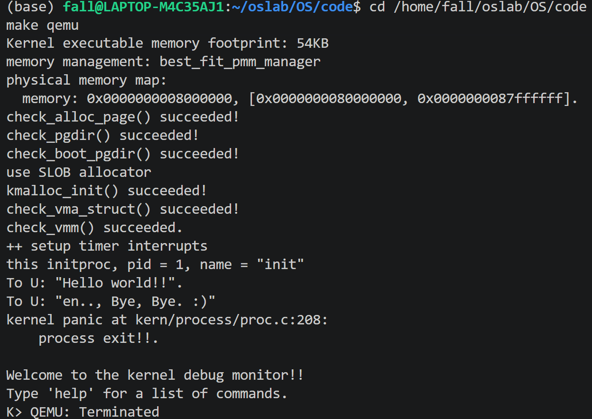
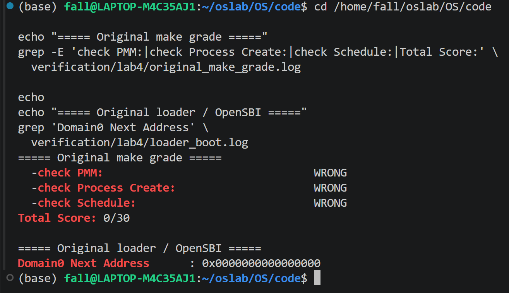
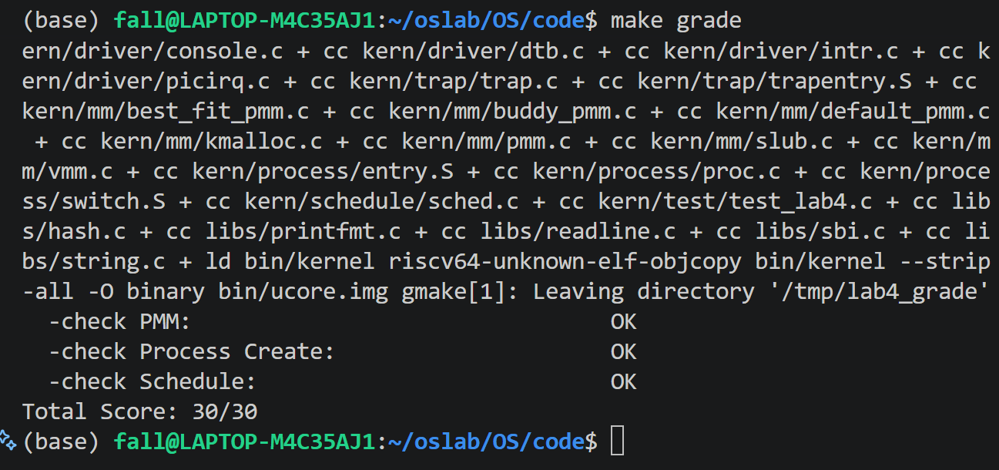

# Lab 4 实验报告：内核线程与进程调度

## 基本信息

- 姓名：王帅
- 学号：2413995
- 实验分支：`lab4`
- 实验方式：个人独立完成
- 实验代码：`code/`
- 验证材料：`code/verification/`

## 1. 实验目标与总体流程

本实验在 Lab 1～3 已完成的启动、物理内存管理、页表基础和 Trap 处理机制之上，补全虚拟内存页操作、内核线程创建以及进程调度与上下文切换三个模块。实验目标是让内核能够建立和维护 Sv39 页表映射，创建第一个内核线程，并由空闲进程通过调度器切换到该线程执行。

内核中与本实验直接相关的执行链如下：

```text
kern_init
  -> pmm_init
  -> pic_init / idt_init
  -> vmm_init
  -> proc_init
  -> cpu_idle
  -> schedule
  -> proc_run
  -> switch_to
  -> forkret
  -> forkrets
  -> __trapret
  -> kernel_thread_entry
  -> init_main
```

其中，虚拟内存模块为进程地址空间和内核线程栈提供页表基础；进程模块负责描述、创建和初始化执行实体；调度模块负责选择下一个可运行进程；`switch_to` 负责真正保存旧上下文并恢复新上下文。调度策略与上下文切换机制彼此分离。

## 2. 虚拟内存页操作

### 2.1 `get_pte()`：Sv39 页表遍历与按需创建

Sv39 使用三级页表，每级索引占 9 位。`get_pte(pgdir, la, create)` 从根页表开始，依次按 `PDX1(la)`、`PDX0(la)` 和 `PTX(la)` 查找。中间级页表项不存在且 `create` 为真时，通过 `alloc_page()` 申请一页作为下一级页表，清零后设置引用计数，并把物理页号写入父级页表项。

本实现对非叶子页表项只设置 `PTE_V`。非叶子项不能携带叶子权限位；如果错误设置 `PTE_U`、`PTE_R`、`PTE_W` 或 `PTE_X`，在较新的 QEMU 中可能被判为保留位组合并导致地址转换失败。若创建第二级页表时内存不足，实现会撤销本次刚创建的上一级页表，清除页表项、恢复引用计数并释放页面，避免部分创建造成内存泄漏。

### 2.2 `page_insert()`：建立或替换映射

`page_insert(pgdir, page, la, perm)` 先调用 `get_pte(..., true)` 得到叶子页表项，然后增加新物理页的引用计数。若虚拟地址已经映射到同一物理页，则抵消刚增加的计数；若映射到另一物理页，则减少旧页引用计数，并在引用数归零时释放旧页。

最终写入的叶子页表项由物理页号、调用者提供的权限以及有效位组成。为了符合当前 QEMU 对 Sv39 Accessed/Dirty 位的处理，实现为有效叶子映射设置 `PTE_A`，对可写映射同时设置 `PTE_D`。映射变更后执行 `tlb_invalidate()`，防止处理器继续使用旧的地址转换结果。

### 2.3 `page_remove_pte()` 与 `page_remove()`：撤销映射

`page_remove()` 以 `create = false` 查找目标叶子页表项，因此删除不存在的映射不会额外创建页表。若页表项有效，`page_remove_pte()` 取得对应 `struct Page`，清除页表项，减少引用计数；引用计数降为零时将物理页交还物理内存分配器，随后刷新对应虚拟地址的 TLB 项。

这套逻辑保证“页表映射数”与页面引用计数保持一致。页表项负责虚拟地址到物理地址的关系，物理页分配器负责页面生命周期，两者不能混为一体。

### 2.4 权限、引用计数与 TLB 的关系

- 权限位决定一次访问是否允许读、写、执行或从用户态访问。
- 引用计数记录一个物理页仍被多少有效映射使用，防止仍在使用的页面被提前释放。
- 修改页表后刷新 TLB，是为了使软件维护的页表状态立即对处理器地址转换生效。
- 页表中保存物理页号，内核访问页表页面时则要通过当前内核映射转换到可访问的虚拟地址。

### 2.5 思考：Sv32、Sv39、Sv48 与接口拆分

Sv32、Sv39、Sv48 的基本遍历思想相同：从根页表按虚拟地址分段索引逐级查找，直到叶子项或无效项。区别主要是页表层数、每级索引位数、页表项宽度和虚拟地址规范位要求。若要同时支持多种模式，适合把“只读查询”和“缺页时创建中间页表”在内部拆成可复用辅助逻辑，并把层数、索引提取和页表项格式参数化；对外仍可保留符合 uCore 调用习惯的 `get_pte(..., create)` 接口。这样既避免各模式重复代码，也能让只读路径明确保证不分配内存。

## 3. 进程创建与初始化

### 3.1 `alloc_proc()`

该函数使用 `kmalloc()` 分配 `struct proc_struct`，清零后设置初始状态：`PROC_UNINIT`、`pid = -1`、内核页表物理地址以及空链表和哈希节点。此时只建立 PCB，不分配内核栈，也不把进程加入全局进程集合。

### 3.2 `copy_mm()`

Lab 4 只创建内核线程，不复制用户地址空间。因此当前进程的 `mm` 必须为空，新线程同样令 `mm = NULL`，并使用 `boot_pgdir_pa`。这一实现不是完整的进程地址空间复制；用户进程的页表复制、共享与写时复制属于后续实验内容。

### 3.3 `copy_thread()`

TrapFrame 被放在新进程内核栈顶端，并复制父调用者准备的初始现场。新线程的返回值寄存器 `a0` 被置零，TrapFrame 中的栈指针按传入参数设置。进程上下文中的 `ra` 指向 `forkret`，`sp` 指向该 TrapFrame，使首次被调度时能够沿 `forkret -> forkrets -> __trapret` 恢复现场，而不是从普通 C 函数返回。

### 3.4 `do_fork()`

`do_fork()` 依次完成 PCB 分配、父子关系设置、内核栈建立、地址空间处理和线程上下文复制。随后在关中断保护下分配 PID，将进程加入 PID 哈希表和进程链表，增加 `nr_process`，并把进程唤醒为可运行状态。任一步骤失败时，函数按已获得资源的逆序释放内核栈和 PCB，避免残留半初始化进程。

### 3.5 `kernel_thread()`

该函数构造一个初始 TrapFrame：用 `s0` 保存线程函数地址、`s1` 保存参数，将 `sepc` 指向 `kernel_thread_entry`，并设置适合 S 模式返回的 `sstatus`。然后调用 `do_fork(CLONE_VM)` 创建内核线程。`kernel_thread_entry` 最终从约定寄存器取出函数和参数并调用目标函数。

### 3.6 `proc_init()`

`proc_init()` 初始化全局进程链表和 PID 哈希表，将当前启动上下文组织为 PID 0 的 `idleproc`，并通过 `kernel_thread(init_main, ...)` 创建 PID 1 的 `initproc`。函数还通过断言检查 PID、进程数量和进程查找关系，保证调度开始前基本进程结构一致。

## 4. 进程调度与上下文切换

### 4.1 `cpu_idle()`

空闲进程在无限循环中检查 `need_resched`。需要调度时调用 `schedule()`；否则继续等待。它保证在没有普通可运行进程时，CPU 始终有一个合法执行实体。

### 4.2 `schedule()`

调度过程先关闭本地中断并清除当前进程的 `need_resched`。它从当前进程之后开始循环扫描进程链表，选择首个状态为 `PROC_RUNNABLE` 的进程；若没有找到，则退回 `idleproc`。选中进程的运行次数增加；若选中者不是当前进程，则调用 `proc_run()`。

当前算法属于简单的循环扫描调度。它完成了“选择谁运行”，但没有优先级、时间片队列或公平性统计等高级策略。

### 4.3 `proc_run()`

`proc_run()` 在关中断保护下切换 `current`，根据目标进程的 `pgdir` 计算并写入 Sv39 的 `satp`，刷新 TLB，然后调用 `switch_to(&prev->context, &next->context)`。对于本实验内核线程，二者使用内核页表；保留地址空间切换步骤是为了与以后用户进程兼容。

### 4.4 `switch_to()`

`switch_to` 按 `struct context` 的真实布局保存旧进程的 `ra`、`sp` 和 `s0`～`s11`，再从新进程上下文恢复这些寄存器并执行 `ret`。这些寄存器是 RISC-V ABI 中需要被调用者保存的寄存器，足以让一个被暂停的内核调用链继续执行。

首次切换到 `initproc` 时，新上下文的 `ra` 不是某个过去的返回点，而是预先设置的 `forkret`，因此控制流会进入 TrapFrame 恢复路径，最后到达 `kernel_thread_entry` 和 `init_main()`。



*图 1：当前参考环境中直接执行 `make qemu`，`initproc` 成功输出预期信息；进入框架预期的 `do_exit()` panic 后，Kernel Debug Monitor 稳定停留在单个 `K>` 等待输入。*

### 4.5 `local_intr_save()` / `local_intr_restore()` 的含义

这两个接口读取并保存当前中断状态，在临界区关闭 S 模式中断，退出时恢复原状态，而不是无条件开中断。它们用于保护进程链表、PID 分配、`current` 和调度切换等不能被本地中断处理流程打断的操作。

关中断是单核环境中防止中断并发的一种手段，但不等价于通用同步锁：它不能阻止其他 CPU 并发访问共享数据，也不自动提供适用于多核的锁语义、所有权管理或等待机制。多核内核仍需要自旋锁等同步原语及明确的内存顺序。

## 5. Prompt / Specification 驱动的实现方法

本实验将任务分为五个阶段：框架整合、页表操作、进程创建、进程调度和最终验收。每个实现 Prompt 都按 `[PROMPT]`、`[RELY]`、`[GUARANTEE]`、`[SPECIFICATION]` 组织：

- `[RELY]` 限定可以依赖的真实文件、数据结构和接口，避免从其他版本 uCore 猜测实现。
- `[GUARANTEE]` 明确必须交付的函数、兼容性和禁止修改的边界。
- `[SPECIFICATION]` 用前置条件、后置条件、分支情况和验证要求描述功能。
- 每个模块先读源码和指导书，再做最小实现、独立编译和完整构建；后续模块未完成造成的链接错误如实记录，不用伪实现绕过。
- 最终验收把功能正确性与评分环境兼容性分开，避免把替代启动结果冒充原始评分结果。

五份完整开发提示词及独立执行记录见 [prompt.md](prompt.md)。

## 6. 调试过程、问题与解决方法

### 6.1 Lab 3 到 Lab 4 的安全整合

没有用 Lab 4 框架整体覆盖已有工程，而是比较同名文件并选择性引入 `kern/process/`、`kern/schedule/`、`kmalloc`、`vmm` 等模块，同时保留 Lab 2 的 Best-Fit、Buddy、SLUB 和 Lab 3 的 Trap 实现。初次完整链接出现 `page_insert`、`page_remove`、`proc_init`、`cpu_idle` 等未定义符号，属于相应练习尚未完成的真实状态。随着三个模块依次实现，这些链接错误逐步消失。

证据：`code/verification/lab4_integration_build.log`、`lab4_module1_full_build.log`、`lab4_module2_full_build.log`。

### 6.2 Sv39 非叶子权限与 A/D 位

最初页表实现暴露出两个环境相关问题：非叶子页表项若设置 `PTE_U` 等叶子权限位，会违反 Sv39 对非叶子项的约束；叶子项缺少 Accessed/Dirty 位时，在当前 QEMU 行为下也可能无法按预期访问。最终非叶子项只保留 `PTE_V`，叶子项设置 `PTE_A`，可写映射再设置 `PTE_D`。同时补充了中间页表分配失败时的回滚，避免资源泄漏。

### 6.3 官方测试回调类型警告

官方测试中的 `test_lab4_thread` 类型为 `void (*)(void *)`，而 `kernel_thread` 的正式接口要求 `int (*)(void *)`。当前 GCC 因此报告 `-Wincompatible-pointer-types`。Makefile 仅将该项从错误降为警告，未改动官方测试和内核接口。在实际官方调度测试中，该测试线程进入无限循环，不从不兼容的返回路径返回，因此本次执行可以完成；但从 C 类型系统看，这仍是应由测试代码或统一接口定义解决的真实不匹配，不能视为完全消除。

### 6.4 QEMU / OpenSBI 启动兼容问题

问题最初出现在 QEMU 7.0.0（`/opt/qemu/bin/qemu-system-riscv64`）和 OpenSBI 1.0 `fw_dynamic` 环境中。老师原始评分命令使用：

```text
-device loader,file=bin/ucore.img,addr=0x80200000
```

该参数会把原始镜像字节写入内存，但在当前组合中不会把 OpenSBI 动态固件的下一阶段入口设置为 `0x80200000`。启动日志显示：

```text
Domain0 Next Address : 0x0000000000000000
```

因此历史失败发生在 uCore 第一条指令执行之前。增加 `force-raw=on` 仍不改变入口。将启动参数临时改为：

```text
-kernel bin/ucore.img
```

时 OpenSBI 能获得 `0x80200000` 作为下一阶段入口，内核和官方测试可以执行。该兼容脚本只在临时工程中调整启动参数，保留了官方测试注入、断言、超时和计分规则；它证明三个功能模块正确，但不能代替原始评分流程。



*图 2：原始 `make grade` 得到 `0/30`，同时 generic loader 启动时 OpenSBI 的 `Domain0 Next Address` 为 `0x0`，说明内核尚未进入执行。*

随后按照指导书参考环境，从 QEMU 官方源码独立构建并安装：

- QEMU 4.1.1：`/home/fall/opt/qemu-4.1.1`
- 默认 RISC-V 固件：OpenSBI v0.4 `opensbi-riscv64-virt-fw_jump.bin`

QEMU 4.1.1 的 `fw_jump` 固件按约定跳转到 `0x80200000`，而 generic loader 已把 `bin/ucore.img` 放在该地址，因此无需修改原始 `grade.sh`。实际使用 Makefile 已有的 `QEMU` 变量执行：

```bash
make QEMU="$HOME/opt/qemu-4.1.1/bin/qemu-system-riscv64" grade
```

三项测试全部为 `OK`，原始评分真实得到 `30/30`。之后 WSL 当前环境已将 `qemu-system-riscv64` 默认解析到上述 4.1.1 安装，因此可以直接执行：

```bash
make qemu
make grade
```

原 QEMU 7.0.0 仍保留在 `/opt/qemu`，没有被覆盖或卸载。

### 6.5 Kernel Debug Monitor 的 `K>` 无限刷屏问题

进入 `do_exit()` 的预期 panic 后，监视器最初会持续高速输出 `K>`。真实调用链为：

```text
kmonitor() -> readline("K> ") -> getchar() -> cons_getc()
```

OpenSBI legacy console 在没有输入字符时返回 `-1`，但 `cons_getc()` 的接口约定是“无输入返回 0”。原实现直接把 `-1` 返回给上层：`getchar()` 只会在返回值为 0 时等待，而 `readline()` 遇到负值会立即返回 `NULL`，于是 `kmonitor()` 马上开始下一轮并再次打印提示符。

最小修复位于 `kern/driver/console.c`，只统一无输入状态，不改变监视器、panic 或进程模块：

```c
return (c < 0) ? 0 : c;
```

修复前，8 秒运行会产生大量重复 `K>`；修复后，`make qemu` 完整输出启动和 `initproc` 信息，监视器只显示一个 `K>` 并持续等待。空等期间没有新增提示符，输入 `help` 能正确列出 `help`、`kerninfo`、`backtrace`，随后重新显示单个 `K>`。重新执行三项官方测试均为 `OK`，说明该控制台输入修复没有造成 Lab 4 功能回归。

## 7. 操作系统原理联系、区别与未覆盖内容

### 7.1 Trap 上下文与进程上下文

TrapFrame 保存中断或异常发生时恢复特权级执行所需的较完整现场，包括通用寄存器和 `sstatus`、`sepc` 等 CSR；`struct context` 只保存内核函数调用约定下跨越 `switch_to` 必须保留的 `ra`、`sp`、`s0`～`s11`。前者解决“从 Trap 返回到哪里”，后者解决“以后如何继续这条内核调用链”，两者作用相关但不能互换。

### 7.2 时钟中断与进程调度

时钟中断提供周期性事件，可以设置 `need_resched` 或驱动时间片耗尽；调度器则根据进程状态和策略选择下一个运行者。本实验的核心调度路径已经建立，但当前调度算法仍是简单扫描，尚未实现完整的时间片轮转、优先级或多级反馈队列。产生时钟中断不等于已经完成调度，真正切换还要经过安全的调度点和 `proc_run()`。

### 7.3 关中断与同步

关本地中断能防止当前 CPU 被中断处理程序重入关键路径，适合本实验的单核内核临界区；锁用于协调多个执行实体对共享数据的访问，尤其是多核并发。两者都服务于原子性，但适用范围和语义不同。

### 7.4 本实验尚未实现的重要机制

- 用户进程独立地址空间、用户态权限和用户栈。
- 完整的 `fork/exec/wait/exit` 生命周期及僵尸进程回收。
- 系统调用、用户态与内核态的完整切换链。
- 请求分页、页面置换、交换、写时复制等高级虚拟内存机制。
- 抢占式时间片调度、优先级调度及公平性策略。
- 多核调度、跨核 TLB shootdown 和多核同步。

老师框架中的 `do_exit()` 仍以 `panic("process exit!!.")` 结束。该输出与 Lab 4 指导书给出的运行阶段相符，表示线程已执行到当前实验边界，不代表已经实现完整进程退出机制。

## 8. 测试结果、证据与限制

### 8.1 真实结果汇总

| 检查项 | 启动方式 | 真实结果 | 证据 |
| --- | --- | --- | --- |
| 默认工程编译 | 当前工程 Makefile | 成功生成内核映像 | `normal_qemu.log` 及阶段构建日志 |
| 正常 QEMU 启动 | 当前 QEMU 4.1.1，直接 `make qemu` | 进入 `init_main()`；预期 panic 后稳定等待于单个 `K>` | 图 1 |
| 历史原始评分 | QEMU 7.0.0 + OpenSBI 1.0 `fw_dynamic` | **0/30**，内核未进入执行 | `original_make_grade.log`、图 2 |
| 历史兼容验证 | QEMU 7.0.0，临时改用 `-kernel` | 三项测试 PASS，**30/30** | `compatible_make_grade.log` |
| 最终原始评分 | QEMU 4.1.1 + OpenSBI v0.4 `fw_jump`，未经修改的 `make grade` | PMM、Process Create、Schedule 全部 OK，**30/30** | 图 3 |

最终结论需要区分三个阶段：QEMU 7 环境下原始评分的历史结果确实为 `0/30`；兼容 `-kernel` 方式曾证明三个模块功能正确，但不是原始评分；复现 QEMU 4.1.1/OpenSBI v0.4 后，未经修改的原始 `make grade` 已真实获得 `30/30`。



*图 3：当前参考环境中直接执行未经修改的 `make grade`，PMM、Process Create 和 Schedule 三项均为 `OK`，最终总分 `30/30`。*

### 8.2 证据文件

- [原始评分日志](../code/verification/lab4/original_make_grade.log)
- [兼容评分日志](../code/verification/lab4/compatible_make_grade.log)
- [兼容启动串口日志](../code/verification/lab4/compatible_qemu_serial.log)
- [generic loader 启动日志](../code/verification/lab4/loader_boot.log)
- [force-raw loader 启动日志](../code/verification/lab4/loader_force_raw_boot.log)
- [正常 QEMU 日志](../code/verification/lab4/normal_qemu.log)
- [验证说明与复现命令](../code/verification/lab4/README.md)
- [原始评分复现脚本](../code/verification/lab4/reproduce_original_grade.sh)
- [兼容评分复现脚本](../code/verification/lab4/reproduce_compatible_grade.sh)

### 8.3 验证边界

- 官方测试、`grade.sh`、`inject.py` 的断言和分值未修改。
- 历史兼容脚本结果与最终原始评分结果分别记录，没有相互冒充。
- Lab 2 的 Buddy/SLUB 源码和 Lab 3 Trap 源码在工程中保留，但本轮 Lab 4 验收没有重新执行 Buddy/SLUB 专项测试，因此不新增其通过结论。
- 当前机器已经独立安装并实际验证 QEMU 4.1.1/OpenSBI v0.4；原 QEMU 7.0.0 仍被保留。
- 回调函数指针类型警告仍然存在，原因和实际影响已在第 6.3 节说明。
